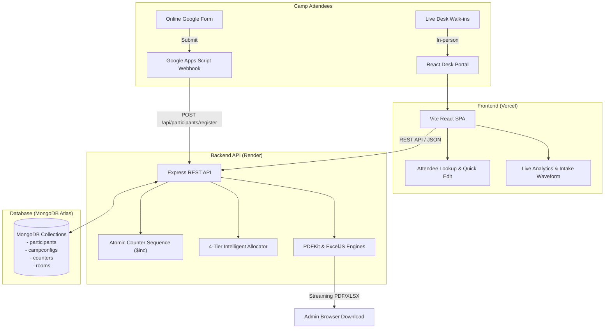

# ⛺ ICPF Camp Registration & Real-Time Management System (2026 Edition)

[](https://react.dev)
[](https://nodejs.org/)
[](https://www.mongodb.com/)
[](https://vitejs.dev/)
[](https://tailwindcss.com/)
[](https://render.com)
[](https://vercel.com)
[-10B981?style=flat-square)]()
[]()

A production-grade, high-throughput camp management web portal built for youth conventions, leadership retreats, and regional conferences. Modernized from legacy Python batch scripts into an atomic **MERN (MongoDB, Express, React, Node.js)** architecture capable of handling simultaneous on-the-spot check-ins and automated live Google Form submissions.

---

## 📑 Table of Contents

- [Key Capabilities](#-key-capabilities)
- [System Architecture & Data Flow](#-system-architecture--data-flow)
- [Algorithmic Allocation Engine (4-Tier Fairness)](#-algorithmic-allocation-engine-4-tier-fairness)
- [Live Registration Desk Workflows](#-live-registration-desk-workflows)
- [Financial & Payment Accounting](#-financial--payment-accounting)
- [Google Apps Script & Forms Integration](#-google-apps-script--forms-integration)
- [Deployment Guide](#-deployment-guide)
  - [1. Backend on Render](#1-deploying-backend-on-render)
  - [2. Frontend on Vercel](#2-deploying-frontend-on-vercel)
  - [3. Database on MongoDB Atlas](#3-setting-up-mongodb-atlas)
- [Local Development Setup](#-local-development-setup)
- [Verification & Automated Test Suite](#-verification--automated-test-suite)
- [Legacy Migration Reference](#-legacy-migration-reference)

---

## ⚡ Key Capabilities

1. **Instant On-The-Spot Allocation:**
   - Registers attendees in real-time and evaluates 10 camp groups (`Group A` through `Group J`) dynamically to balance sizes, age distributions, and gender ratios.
2. **Strict Gender-Segregated Dorm Assignments:**
   - Enforces physical room capacity constraints and 100% gender separation (`Male` attendees are never placed in female dorms, and vice versa).
3. **Single & Group Check-In Modes:**
   - Supports individual attendees and batch registrations for families, siblings, or church groups under a pastor/guardian with an option to preserve requested group affinity.
4. **Attendee Lookup & Desk Verification:**
   - Real-time search by name, church, city, phone, or badge serial number. Allows quick inline payment edits and administrative group/room overrides.
5. **Live Camp Analytics & Intake Waveform:**
   - Tracks total attendees, residential vs. day scholars, mean age per group, dorm occupancy quotas, intake velocity waveform, and financial metrics.
6. **Dual Document Export:**
   - Generates 6-card-per-A4 physical ID badges (PDF), printable room occupancy rosters with signature blocks (PDF), and full attendee Excel spreadsheets (`.xlsx`).
7. **Zero Race Conditions under High Concurrency:**
   - Powered by an atomic MongoDB sequence counter (`backend/models/Counter.js`) with exponential retry loops, eliminating duplicate serial collisions under 25+ requests/sec bursts.

---

## 🏛 System Architecture & Data Flow



---

## 🧠 Algorithmic Allocation Engine (4-Tier Fairness)

The allocation engine evaluates candidate teams deterministically using a 4-tier lexicographical scoring system:

| Priority | Tier Name | Objective | Mathematical Optimization |
| :---: | :--- | :--- | :--- |
| **Tier 1** | **Headcount Parity** | Keep all 10 groups roughly equal in total size. | $\min(\text{count}_t)$ across candidate teams. |
| **Tier 2** | **Gender Balance** | Equalize male/female ratios in every group. | $\min(|\text{males}_t - \text{females}_t|)$ from Tier 1 candidates. |
| **Tier 3** | **Age Dispersion** | Maximize age diversity within each team. | $\max(\min_{p \in t} |\text{age}_{\text{camper}} - \text{age}_p|)$ from Tier 2. |
| **Tier 4** | **Church Dispersion** | Prevent congregational clustering. | $\min(\text{count}(\text{church}_t))$ from Tier 3. |
| **Tie-Breaker** | **Anti-Consecutive Spacing** | Avoid allocating successive walk-ins to the same team. | Penalizes `lastAssignedTeam` if alternative tied teams exist. |

---

## 🖥 Live Registration Desk Workflows

```
┌────────────────────────────────────────────────────────────────────────┐
│                        ICPF CAMP 2026 DESK PORTAL                      │
├──────────────────┬──────────────────────┬──────────────────────────────┤
│  [Check-in Desk] │  [Attendee Lookup]   │  [Live Stats & Analytics]    │
└──────────────────┴──────────────────────┴──────────────────────────────┘
```

1. **Check-In Desk (`Single` & `Group` mode):**
   - **Single Attendee:** Input camper demographics (Name, Age, Gender, Church, Location, Staying, Phone, Fee & Payment Status).
   - **Group Registration:** Ideal for parents or pastors registering multiple youths. Provides an option to keep them in one group or divide them evenly across diverse groups.
2. **Attendee Lookup & Verification:**
   - Search by name, serial number, or church.
   - Quick action pill to edit payment notes, update amount paid, or adjust fee totals without opening heavy modals.
   - One-click exports: **Excel Roster**, **Badges PDF (6-up)**, and **Room Rosters PDF**.
3. **Admin Override Modal:**
   - Change assigned group or assigned room with real-time bed capacity validations and dorm gender checks.

### 📱 Mobile Desk Use

The portal is designed to be run from phones at the registration counter:

- **Bottom navigation** (Desk / Lookup / Insights) replaces the top tab bar below 768px; the top bar keeps only the camp title, refresh, and day/night toggle so it always fits.
- **Attendee Lookup** switches from a table to thumb-friendly cards below 768px, with Quick Edit and Override buttons sized for touch.
- The **Quick Edit** payment/notes modal scrolls within the viewport (`max-h-[92dvh]`) and its fields stack on narrow screens, so Save is always reachable with the keyboard open.
- The decorative Three.js background is disabled on phones (<768px) to save battery and GPU at a busy desk; form fields stay at 16px so iOS Safari never auto-zooms on focus, and pinch zoom is allowed.
- If a single row ever overflows, the page itself never scrolls sideways (`overflow-x: clip`); wide tables scroll inside their own container.

---

## 💰 Financial & Payment Accounting

The portal incorporates full payment lifecycle tracking:
- **Fee Presets:** `₹500` (Standard Full Camp), `₹400` (Day Scholar/Subsidized), `Custom Amount`, or `₹0` (Exempt / Volunteer).
- **Payment Methods:**
  - `Paid Online` (UPI / GPay / Net Banking)
  - `Paid Cash` (Collected at registration counter)
  - `Partial / Balance Due` (Attendee owes remaining balance)
  - `Waiting Payment` (Unpaid arrival)
  - `Refund / Balance to Return` (Overpayment reconciliation)
  - `Exempt` (Invited faculty / camp pastors)
- **Live Cash Flow Aggregation:** Financial telemetry cards monitor collected cash, online volume, pending dues, and accounts payable in real-time.

---

## 📬 Google Apps Script & Forms Integration

Real-time sync between Google Forms / Google Sheets and the registration backend is powered by Google Apps Script:

### 1. Webhook Setup
1. Open your Google Form's linked Google Sheet.
2. Go to **Extensions > Apps Script**.
3. Paste the contents of [`google_apps_script/Code.gs`](google_apps_script/Code.gs).
4. Update the endpoint URL with your Render backend address:
   ```javascript
   const BACKEND_URL = "https://icpf-camp-backend-2026.onrender.com/api/participants/register";
   ```
5. Click **Triggers (alarm icon)** > **Add Trigger**:
   - Event Source: `From spreadsheet`
   - Event Type: `On form submit`

### 2. Live Payload Format
When an attendee completes the Google Form, Apps Script posts this payload to the backend:
```json
{
  "name": "Ebenezer Mathew",
  "age": 21,
  "gender": "Male",
  "church": "IPC Bethel",
  "location": "Kottayam",
  "staying": true,
  "phone": "+919876543210",
  "paymentStatus": "Paid Online",
  "amountPaid": 500,
  "feeTotal": 500,
  "notes": "Registered via Google Forms"
}
```

---

## 🚀 Deployment Guide

### 1. Deploying Backend on Render

1. Sign up / Log in to [Render](https://render.com).
2. Click **New +** > **Web Service**.
3. Connect your GitHub repository: `https://github.com/Allen203060/icpfRegistrationPortal2026.git`.
4. Configure the service settings:
   - **Name:** `icpf-camp-backend-2026`
   - **Root Directory:** `backend`
   - **Runtime:** `Node`
   - **Build Command:** `npm install`
   - **Start Command:** `npm start`
5. Under **Environment Variables**, add:
   | Key | Value | Description |
   | :--- | :--- | :--- |
   | `NODE_ENV` | `production` | Enables production optimizations |
   | `PORT` | `10000` (Render default) | Render sets this automatically |
   | `MONGO_URI` | `mongodb+srv://<user>:<pwd>@cluster.mongodb.net/icpf_camp_2026` | MongoDB Atlas URI |
   | `CLIENT_URL` | `https://your-frontend.vercel.app` | Allowed CORS origins |
6. Click **Create Web Service**. Verify health at `https://your-app.onrender.com/api/health`.

*(Alternatively, use the included [`render.yaml`](render.yaml) Blueprint for automated one-click infrastructure provisioning.)*

---

### 2. Deploying Frontend on Vercel

1. Log in to [Vercel](https://vercel.com).
2. Click **Add New...** > **Project**.
3. Import your GitHub repository (`icpfRegistrationPortal2026`).
4. In the Project Configuration:
   - **Root Directory:** Click Edit and select `frontend`.
   - **Framework Preset:** `Vite`
   - **Build Command:** `npm run build`
   - **Output Directory:** `dist`
5. Under **Environment Variables**, add:
   | Key | Value |
   | :--- | :--- |
   | `VITE_API_URL` | `https://your-backend-service.onrender.com` |
6. Click **Deploy**. Vercel will build the frontend and serve it with client-side SPA routing governed by [`frontend/vercel.json`](frontend/vercel.json).

---

### 3. Setting Up MongoDB Atlas

1. Create a free M0 cluster at [mongodb.com/atlas](https://www.mongodb.com/atlas).
2. Create a Database User with read/write privileges.
3. In **Network Access**, add `0.0.0.0/0` (allow access from anywhere) so Render instances can connect.
4. Copy the connection string into Render's `MONGO_URI` environment variable:
   ```
   mongodb+srv://<username>:<password>@cluster0.abcde.mongodb.net/icpf_camp_2026?retryWrites=true&w=majority
   ```
5. On the first server boot, the backend automatically seeds the 10 groups (`Group A` – `Group J`) and default rooms into the database.

---

## 💻 Local Development Setup

### Prerequisites
- Node.js v20.x or higher
- MongoDB running locally on `localhost:27017` (or remote Atlas instance)

### 1. Clone & Install
```bash
git clone https://github.com/Allen203060/icpfRegistrationPortal2026.git
cd icpfRegistrationPortal2026

# Install backend dependencies
cd backend && npm install && cd ..

# Install frontend dependencies
cd frontend && npm install && cd ..
```

### 2. Configure Environment Files
```bash
# Backend configuration
cp backend/.env.example backend/.env
# Edit backend/.env if using a custom MongoDB connection
```

### 3. Start Development Servers
From the repository root:
```bash
# Start backend API (runs on http://localhost:5000 with --watch)
npm run dev:backend

# In a separate terminal, start frontend dev server (runs on http://localhost:5173)
npm run dev:frontend
```

---

## 🧪 Verification & Automated Test Suite

The system includes comprehensive automated testing across core services, allocator heuristics, API endpoints, and document generation:

```bash
# Run the complete test suite (43 automated tests)
npm test

# Run individual module tests
npm run test:allocator   # 4-tier heuristic diversity & room constraints
npm run test:api         # REST endpoints, error validation, CRUD
npm run test:export      # PDF magic bytes & Excel workbook generation
```

### High-Throughput Concurrency Load Test
Verify that atomic counter sequencing prevents serial duplicate key collisions under simultaneous registration load:
```bash
# Simulates 80 rapid registrations firing in bursts at 20-30 RPS
npm run test:load
```
*Target Result: 100% success rate, 0 duplicate keys, and 0 dorm cross-gender allocations.*

---

## 📂 Repository Structure

```
icpfRegistrationPortal2026/
├── backend/
│   ├── config/              # Database connection and 2026 camp presets
│   ├── controllers/         # HTTP request handling (participants, config, exports)
│   ├── middleware/          # Schema and payload validation middleware
│   ├── models/              # Mongoose models (Participant, Counter, CampConfig)
│   ├── routes/              # Express API route declarations
│   ├── services/            # Allocator heuristics, ExcelJS & PDFKit engines
│   ├── tests/               # Unit, integration, and concurrency load tests
│   ├── server.js            # Express app entry point & CORS configuration
│   └── package.json
├── frontend/
│   ├── src/
│   │   ├── components/      # Modular UI components (checkin, lookup, dashboard, print)
│   │   ├── services/        # API client with dynamic VITE_API_URL resolution
│   │   ├── App.jsx          # Root application with theme switcher & tab routing
│   │   └── main.jsx
│   ├── vercel.json          # SPA routing configuration for Vercel
│   ├── vite.config.js       # Vite configuration with chunk splitting
│   └── package.json
├── google_apps_script/      # Google Forms webhook integration code
├── legacy_python_scripts/   # Archived 2025 Python scripts for historical parity
├── render.yaml              # Render Blueprint deployment definition
├── package.json             # Root monorepo orchestration scripts
└── README.md
```

---

## 📜 Legacy Migration Reference

The original 2025 Python batch scripts (`script_groups.py`, `script_rooms.py`, `script_cards.py`, `master_script.py`) have been safely moved to [`legacy_python_scripts/`](legacy_python_scripts/). The current MERN architecture reproduces and enhances all historical allocation logic with real-time web responsiveness, atomic database transactions, and an intuitive UI.

---

### Developed for ICPF Camp 2026
Built with care for seamless camper intake, fair group fellowship, and stress-free camp administration. ⛺
